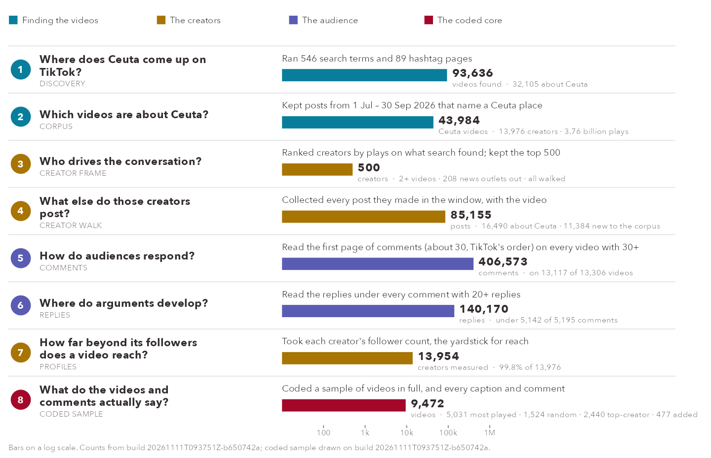
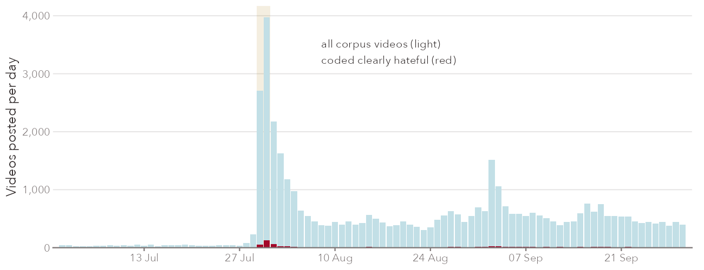
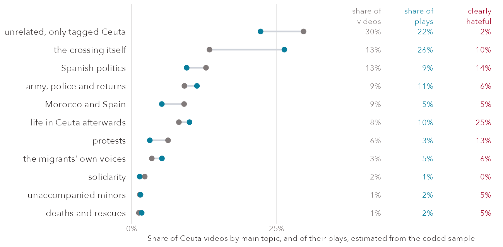
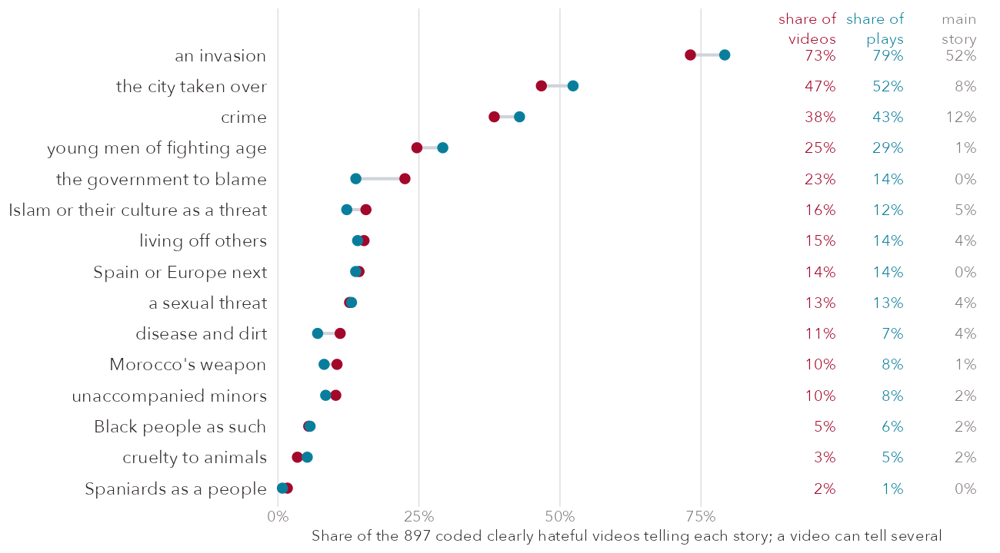
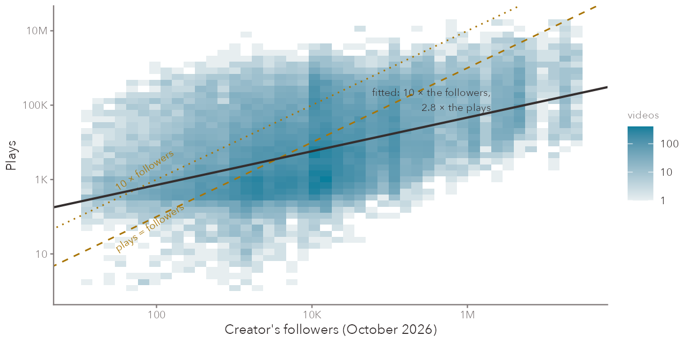
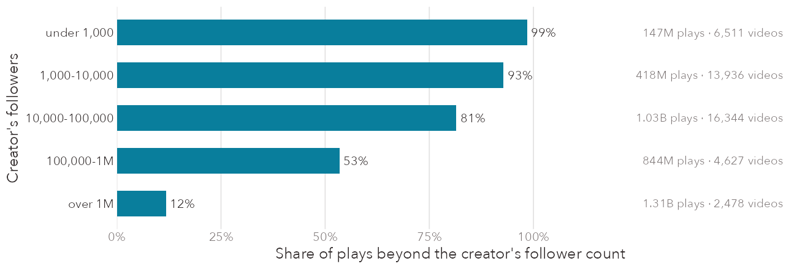
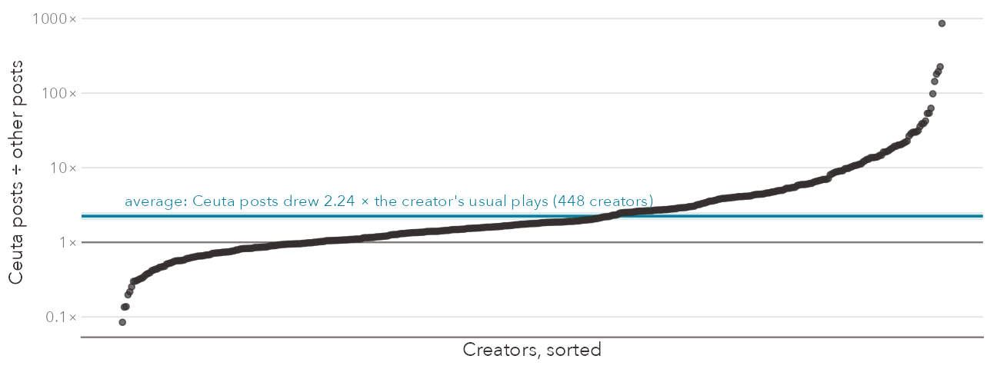
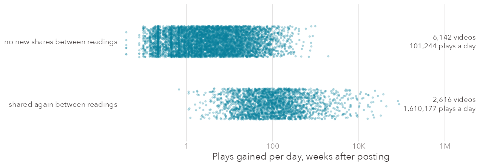
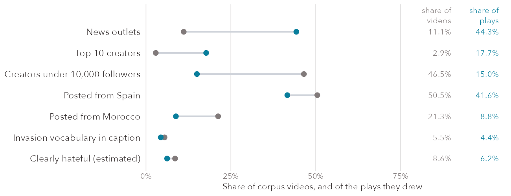
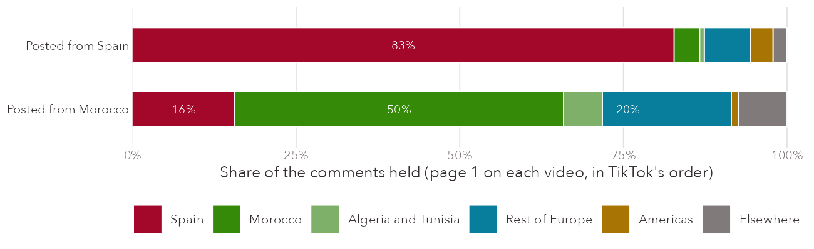

**Do human and algorithmic spread of hate speech differ, and do
platforms show people hate they didn’t look for?**

From outside, no one can see why a platform showed a video, so we cannot
say what the algorithms did. What the public counts show is that hate
spread widely and appears to have had little moderation from the
platforms. The clearly hateful videos we found drew 200 million plays,
and TikTok had put a warning or sharing limit on 12 of 897. At the top
of X, 30% of posts were clearly hateful, with 29% of the views. Part of
the explanation is what draws engagement: on TikTok, viewers shared and
commented on hateful videos about twice as often as on other videos, and
at the top of X, hateful posts were reposted about a quarter more often.

On TikTok we analysed 43,984 videos that name Ceuta, posted 1 July to 30
September 2026 by 13,976 accounts and played 3.76 billion times, with
406,573 comments and 140,170 replies. On X we analysed 9,118 posts from
the same months that name the place, by 1,428 accounts and viewed 1.95
billion times: the most-engaged, and the community partner’s accounts,
terms and hashtags. A language model coded 9,472 of the videos in full,
every caption and nearly every comment, and every X post.

# Key findings

**TikTok**

- **About 8.6% of Ceuta videos were clearly hateful** (here meaning
  attacking, dehumanising or generalising negatively about people for
  their religion, ethnicity, race, nationality or migration status), and
  8.5% more borderline: hostile by insinuation, not counted as hate.
  They drew 6% of the plays, 13% with borderline ones.
- **Almost none of what we found came down.** All 897 were up when last
  read, a median 56 days after posting; anything removed before
  collection began is missing. A check of their accounts on 19 October
  found three gone and three probably gone; later ones were not checked.
  We use Southport’s definition, not TikTok’s; TikTok says 92% of its
  hate removals come within a day.[^1]
- **TikTok unlinks some hashtags, ordinary words among them.** 27 of 108
  hashtags are unlinked: their tag page is empty although videos carry
  the tag, and on a post the tag shows as plain text, not a link. They
  include \#الانتخابات, \#menas, \#remigration, \#haraga,
  \#grandremplacement. View counts show no sign these videos were held
  back (1.35 times their creators’ usual plays).
- **Viewers shared and commented on hateful videos about twice as often
  as on others.** They drew a median of 4.7 shares and 2.5 comments per
  1,000 plays, against 2.5 and 1.1 (videos with 1,000+ plays), and 1.24
  times the shares of the same creators’ other Ceuta videos. Posting
  about Ceuta earned plays (2.24 times a creator’s other posts; 1.20 for
  videos our searches never returned). Hate earned none on top (0.89
  times their other Ceuta videos; 45 creators; up to 1.26 is possible).
- **Hate in the comments was mostly in the replies, where people
  argued.** 6.8% of replies in long threads were clearly hateful,
  against 0.3% of top comments.
- **News outlets’ own headlines carried over a quarter of the hate’s
  reach**, 29% of the plays on clearly hateful videos (outlets drew 44%
  of all plays). OKDIARIO, whose whole feed we read, drew 17%.
- **Nearly half the hate was not in the caption** (48%). Read alone,
  captions missed 74% of it.
- **Attention came in the first four days.** Videos posted 30 July to 2
  August drew 50% of the plays.

**X** (Section 7)

- **We read two sets of posts on X and report them apart.** The top of
  X: 3,140 posts with 5,000 or more likes, from 1,067 accounts, with 89%
  of the views on the 8,968 we compare. The partner’s accounts: 21 from
  the partner’s list, 5,513 posts, 57% with under 500 likes.
- **At the top of X, posts in English were hateful twice as often as
  posts in Spanish** (47% against 21%). The targets were migrants and
  asylum seekers, then Moroccans, then Muslims.
- **The partner’s accounts differ widely.** 24% of their posts were
  clearly hateful, from 4% to 56% among those with 20+ posts. Their
  posts at the top of X were hateful more often than other accounts’
  there (37% against 28%): they are 14% of top posts and 18% of the
  hateful ones.

**TikTok and X**

- **The top of X was more hostile than the top of TikTok.** 30% of X’s
  top posts were clearly hateful, against 8.5% of TikTok’s most-played
  videos. In Spanish the gap is smaller: 21% of X’s top posts in
  Spanish, against 13% of TikTok’s most-played videos from Spain.
  Clearly hateful posts drew 29% of the views on X’s top posts, against
  6% of the plays on TikTok’s coded videos.
- **Both platforms told the arrival as an “invasion”.** 73% of TikTok’s
  clearly hateful videos and 74% of X’s clearly hateful top posts did.
  Calling the arrival an invasion in a post’s own voice counts as hate
  here, news outlets included. 8% of those videos and 5% of those posts
  called for violence.
- **Hateful content was concentrated on both platforms.** The ten
  accounts with the most plays or views on hate drew about a third of
  them (33% on TikTok, 36% at the top of X).
- **Hate reached beyond followers about as often as other top content.**
  77% of TikTok’s most-played hateful videos and 44% of X’s top hateful
  posts were seen more times than their author has followers, against
  71% and 52% of all top items (plays and views, not people).

# Limitations

- **Our searches found the popular videos more easily than the rest.**
  Most videos come from TikTok’s search and hashtag pages, which favour
  videos that did well. We estimate they found 24% of the Ceuta videos
  search could return, but 66% of their plays, so small accounts are
  under-represented.

- **We only saw what was still online.** Collection began on 29
  September, two months after the crossings, so anything removed before
  then is missing. Of the videos we collected, at least 175 had gone by
  19 October (37 million plays) and 64 more were probably gone. Too few
  went to tell whether hateful videos went faster: 1.1% of those with a
  clearly hateful caption (3 of 280), against 0.9% of the others. The
  most extreme material may go fast: TikTok removed 88% (July) and 100%
  (August) of the items Spain’s racism observatory (OBERAXE) flagged as
  probably illegal.

- **A language model did the coding, with no human coder.** Claude Haiku
  5.5 coded 9,472 videos in full, every caption, all but 32 comments,
  and the themes and topics. In our Southport study it agreed with a
  second model on 91% of posts (0.69 on a 0-to-1 agreement scale); we
  ran no such check here. Speech recognition mishears most Moroccan
  Arabic words (87% even for the full model we did not use, against 6%
  for Spanish), so the rate for videos from Morocco may be too low. Read
  the comment codes as showing which way things lean, not as precise
  rates.

- **On X we read a selection.** Deleted posts and suspended accounts are
  missing, as are replies that do not name Ceuta, and Arabic is almost
  absent. The model read text and images but only a video’s preview
  frame, and did not say whether a post adopts or only reports the
  hostility.



# Method

- The TikTok data are public TikTok records, read from 29 September to
  11 November 2026 through EnsembleData (EnsembleData Pte. Ltd.,
  Singapore), a commercial provider of public TikTok data. The X posts
  (Section 7) are public posts, read through X’s own API (full-archive
  search) on 11 and 14 November 2026. The deletion check (step 11) asked
  TikTok’s own embed service, and the spot checks in step 10 used
  TikTok’s website and app.
- Since 9 October we have logged every request, its cost and who
  approved it. Earlier requests are rebuilt from saved responses or a
  results spreadsheet. Each rebuild of the data passes integrity checks
  before any number is drawn from it.
- Every TikTok count here is a query on build 20261111T093751Z-b650742a.
  The X counts are from the posts as read on 11 and 14 November.

**1. Where does Ceuta come up on TikTok? Discovery.**

- We searched TikTok the two ways a user can: keyword search, for 546
  terms, and the hashtag pages of 89 tags.
- Both lists started from our own list of Ceuta’s names, the crossing
  points and the slogans of the event, and were mostly written by hand.
  Two rounds on 8 October produced 442 of the keyword terms, most
  pairing a place name with a word for what happened. The lists also
  grew by snowball: terms that recurred in early results were searched
  in turn. That added 24 keyword terms and 24 tags on 11 October, after
  a partial first round on 8 October (20 and 37). Eticas’s requests of
  20 October and 4 November are below.
- The searches returned 93,636 videos, 32,105 of them Ceuta videos (step
  2). Keyword search returned 55,715 (17,874 Ceuta videos) and the
  hashtag pages 43,123 (17,939).
- On 20 October, at Eticas’s request, we added \#CeutaNoEstaSola by
  hashtag page and keyword. \#CeutaseDefiende, also requested, was
  already searched. We read the new videos’ comments and replies and
  froze the data again. That added 212 videos.
- On 4–5 November, at Eticas’s request, we read the July–September posts
  of the eight key accounts named by its community partner whose posts
  we had not yet read in full. We also searched the partner’s terms not
  yet searched: \#CloseTheBorders, “hombres en edad militar” and “moros”
  (“emergencia nacional” only as one word, searched in October, and in
  place pairs). Muslim and musulmanes were searched only in pairs with
  each place name, as alone they would return posts about Muslims
  everywhere. We read the new videos’ comments and replies, coded them,
  and froze the data again. That added 433 videos. These accounts were
  read a month after the others, so their videos had longer to gather
  plays.
- Both routes follow TikTok’s own rankings and favour videos that have
  already done well. We estimate coverage by comparing what the two
  routes found, band by band of plays (a capture–recapture estimate).

**2. Which videos are about Ceuta? The corpus.**

- A video is in the corpus if it was posted on or after 1 July and
  before 1 October 2026, names Ceuta or a crossing point in its caption
  or hashtags, and we collected TikTok’s own record of it.
- The 12 place terms are in Spanish and Arabic. They include Melilla,
  and 1,836 videos name Melilla but no Ceuta term.
- The corpus holds **43,984 videos by 13,976 accounts, with 3.76 billion
  plays.**
- Discovery found 32,105 of them. Another 11,384 were found only by the
  creator walk (step 4), and 495 only by an earlier, shorter read of the
  same creators’ posts on 6–7 October.
- We collected a usable video file for 37,588. Most of the rest are
  5,671 photo posts.
- We left out 109,649 videos from the window that never name Ceuta
  (mostly other posts by the walked creators), 67,142 posted outside the
  window, and 2,408 known only from an earlier collection’s spreadsheet.
- Counts are as collected in October. 9,611 videos were counted twice,
  when each was at least three weeks old. The two counts were at least
  three days apart (a median of 6 days). Videos from the creator walk
  are over-represented among them.

**3. Who drives the conversation? The creator frame.**

- We ranked creators by the plays on their Ceuta videos found in step 1,
  so nothing added in later steps could move a creator in or out.
- We kept creators with at least two such videos, because one viral clip
  is not sustained engagement. On this build that is 4,074 creators; the
  frame itself was fixed on the 20 October data.
- We removed 208 news outlets, identified by hand from their handles and
  profiles, and kept the top 500. They drew 22% of the plays on the
  Ceuta videos discovery found.
- Three accounts on the outlet list were later judged personal. They
  count as ordinary creators everywhere, but the frame had been fixed
  before then. They would have ranked 87th, 169th and 245th, and their
  posts were not read in full (step 4).

**4. What else do those creators post? The creator walk.**

- For each creator in the frame, we collected the posts in the window
  their profile showed, Ceuta or not, up to 64 pages back, with counts
  taken the same day. This is the creator walk.
- We walked all 500; 13 returned no posts (private or emptied accounts).
  We also walked 377 creators outside the frame: 7 at the community
  partner’s request on 4 November, and the rest under earlier rankings
  or a 14–15 October settings error. They are kept, labelled, and left
  out of every frame figure.
- The 877 creators we walked made 85,155 posts in the window, 16,490 of
  them Ceuta videos. Search had not returned 11,384 of these Ceuta
  videos, which join the corpus, labelled.
- **The comparison in Section 3.** For each creator in the frame with at
  least three other posts, we compare the mean log plays of their Ceuta
  posts with those of their other posts.
  - Each creator’s most-played Ceuta post is left out, as it usually
    brought them into the study.
  - The frame was chosen on the plays of Ceuta posts that search found,
    so the result is an upper bound. Posts that search never returned
    played no part in the choice.
  - The test for a hate premium (extra plays for hateful posts) compares
    each creator’s hateful and non-hateful Ceuta posts, among the 100
    creators whose Ceuta posts were all coded.
  - Ranges are 95% bootstrap ranges over creators (2,000 draws, fixed
    seed). With 448 creators, the Ceuta comparison can detect a premium
    as small as 1.17 times. The hate test, on 45 creators, is far weaker
    (range 0.61 to 1.26).

**5. How do audiences respond? Comments.**

- For every corpus video with 30 or more comments (13,306), we collected
  the first page TikTok returns, usually 30 top-level comments and
  sometimes more. The exception is @davidsantosvlog’s videos, added on
  11 November. The comment collection cannot be limited to one account,
  so their comments were not read.
- That page is in TikTok’s own order, not sorted by likes. TikTok says
  likes and language weigh most for most users (TikTok n.d.-a), so it is
  our best estimate of what most viewers saw first.
- That gives 406,573 comments from 318,154 accounts, on 13,117 of those
  videos (13,206 videos in all, counting a few below 30 at the last
  count).
- 26,206 of them are text from an earlier collection of the same videos,
  marked as such and with no account.

**6. Where do arguments develop? Replies.**

- Under every top-level comment with 20 or more replies (5,195), we
  collected the first page of replies. That gives 140,170 replies under
  5,142 comments.
- Threads were collected largest first. On 16–17 October the threshold
  was 30 replies (2,997 of 3,026 threads), and on 18 October we lowered
  it to 20.

**7. How far beyond its followers does a video reach? Profiles.**

- A video’s follower count comes from its own record where TikTok gives
  one, otherwise from the creator’s profile.
- 13,954 of the 13,976 creators have a follower count, 7,789 from video
  records and 6,165 from profiles. 22 have none.
- **The measure in Section 3.** Plays beyond the followers are plays
  minus followers, where that is positive, as a share of all plays. It
  counts one play per follower, so it is a floor on reach beyond the
  following only if followers add at most one play each.

**8. What do the videos and comments say? The coded sample.**

- Only videos whose file we held when the sample was drawn could be
  coded from the whole video. There were 37,585 (topped up on 20 October
  and 5 November), excluding photo posts.
- The sample is the 5,031 most-played of those videos, 1,524 drawn at
  random from the rest (fixed seed), and, for Section 3, the Ceuta
  videos of the 100 most-played creators in the frame: 9,472 videos in
  all.
- Estimates weight the most-played and random draws to the 37,585
  videos, leaving out the creators’ Ceuta videos.
- When we froze the data again on 20 October, the sample was kept as
  drawn. A new video with at least the plays of the least-played top
  video joined the most-played group, and the rest were drawn at the
  original rate (second fixed seed). The other 194 new videos were coded
  too. They count in totals, but enter estimates only through that draw.
  The 4 November top-up was added the same way, and its other 282 new
  videos were also coded.
- For each sampled video we took the on-screen text from one frame a
  second and a set of frames. Where there was speech, we transcribed it
  on our own machines with Whisper large-v3-turbo (1,534 videos had
  none). Whisper’s full large-v3 model gets about 6% of Spanish words
  wrong (Radford et al. 2022) and 87% of Moroccan Arabic words (Talafha
  et al. 2024). The faster turbo version we ran does somewhat worse,
  most of all on Moroccan Arabic.
- Every corpus caption was also coded on its own, to measure what a
  caption-only method misses. All but 32 of the comments and replies
  collected were coded, one whole comment section per request.

**9. What did the coding ask?**

- **The model.** Claude Haiku 5.5, through Anthropic’s batch service, in
  three stages. It reads the caption and hashtags, on-screen text,
  transcript and frames, but cannot hear the audio.
- **Stage 1** covers every sampled video: whether it is hateful (yes,
  borderline or no) and the words or image that decided it, its stance,
  claims over the city, calls to protest (613 videos) or violence (113,
  76 of them clearly hateful), and what the frames show.
- **Stage 2** covers videos judged yes or borderline: who is targeted,
  where the hostility is (caption, on-screen text, speech or images),
  and whether the video adopts, mocks, reports or condemns it.
- **Stage 3**, added on 24 October, covers the same videos: the stories
  the hostility tells, how it tells them and what it asks for (Section
  2). The list of stories was drawn up from the stage 1 and 2 notes on
  about 230 clearly hateful videos, before any theme was coded. Stage 3
  never changes stage 1’s code.
- **Topics** cover every sampled video, from its text and stage 1’s
  description of the frames: what it is about and how it shows the
  people who crossed. The model was told not to judge hate.
- **The definition** is Southport’s, word for word: content that
  attacks, dehumanises or generalises negatively about people because of
  religion, ethnicity, race, nationality or migration status. It was
  written for these cases, not taken from a published codebook. It
  follows the UN’s working definition, which describes hostility to
  people “on the basis of who they are” (United Nations 2019).
  - *Yes:* a negative trait attributed to the group as a whole
    (criminals, invaders, disease, a sexual threat), a slur (“menas” as
    a slur, “moros”, “invasores”), or a call to remove or harm them.
  - *Borderline:* hostility through insinuation or policy talk tied to
    the event. The prompt’s examples include “efecto llamada” (“pull
    factor”), a phrase also used in mainstream politics.
  - *No:* everything else, including reporting on or condemning hate. If
    unsure between borderline and no, the answer is no.
  - *Not hate:* hostility to Vox, the Spanish or Moroccan state, police,
    Frontex, the EU, the King or politicians. Claims over the city are
    recorded separately.
  - *Whose words:* an interviewee’s or politician’s words, passed on
    without being adopted, count as reporting (no). The video’s own
    caption, narration or titles count, even from an outlet.
  - *Newsroom wording:* “avalancha” or “marea humana” in an outlet’s own
    narration should be coded no, but the model did not always follow
    this.
- **Too little to judge.** A video judged no that had at most one of a
  caption, on-screen text and a transcript is left out of the rates (128
  videos).
- **Captions alone** are coded with the same definition. With only the
  caption to read, the coding leans on hashtags, and a lone \#invasion
  often decides “yes”.
- **Checks.** No second coder. On Southport, Haiku 5.5 found 8.4% of
  posts clearly hateful and Sonnet 5.5 found 7.1%. They agreed on 91%
  (Cohen’s κ 0.69), and 96% of their disagreements involved borderline,
  which is why we lead with “clearly hateful”. Stage 2 found that 162
  hateful or borderline videos only reported, condemned or mocked the
  hostility. They keep stage 1’s code.
- **The full prompts**, word for word, are in `codebook.md` in the data
  package.

**10. Which hashtags does TikTok unlink? Tag pages.**

- On 18 October we collected the first page of 108 hashtag pages: our
  main discovery tags, tags whose posts’ captions came back empty in the
  app data, their near-twins, and 25 ordinary tags.
- A tag counts as unlinked if its first page is empty even though videos
  in the corpus carry it. On TikTok’s website, such a tag shows in a
  post’s caption as plain text, not as a link. The data package’s files
  call these tags `blocked`.
- **The detector.** In the data that TikTok’s app returns, the captions
  of posts with an unlinked tag come back empty while the tags remain.
  That is a property of the data, not of what viewers see.
- **The website.** Logged out, TikTok’s website says “Couldn’t find this
  hashtag” for every tag page, so the test rests on the provider’s data.
  On the website we checked one post each for \#menas, \#remigration,
  \#haraga and the Arabic for “the elections”. This is a spot check, not
  a rate.
- **Views.** For each creator with at least three other posts, we divide
  the median views of their posts with an unlinked tag by the median of
  their other posts. We pool across tags, because too few creators use
  any one tag.

**11. What went after collection? The deletion check.**

- On 19 October we asked TikTok’s public embedding service
  (tiktok.com/oembed) whether 3,336 accounts were still public: every
  creator who then had a video coded hateful or borderline, and a random
  600 with neither.
- Part-way through that day the service stopped telling live videos from
  deleted ones. Only the 78 video checks made before then count; the
  rest were checked through their accounts.
- A video counts as gone if its own check failed, or if its account
  stopped answering and our data had already shown the account empty or
  private. If the account only stopped answering under the name we held,
  the video counts as probably gone, since a change of name looks the
  same.
- Every 50 requests, the check asked about a made-up account, which must
  fail, and El País, which must pass. All 68 pairs gave the expected
  answers.
- For comparison, 12% of TikTok posts are gone within 26 days (Steel et
  al. 2026). On Twitter, hateful posts were only slightly more likely
  than others to disappear (Tonneau et al. 2026).
- By the codes on this build, 5 of the 431 accounts behind clearly
  hateful videos that we checked were gone. Among the random accounts
  that still have no hateful or borderline video, 10 of 599 were gone.
  Both are too few to compare.
- The 212 videos added on 20 October, the 433 added on 4–5 November and
  the three added on 11 November were not checked.



# 1. The crossings and the data

- On Thursday 30 July 2026, Morocco’s Throne Day, tens of thousands of
  people entered Ceuta from Morocco, most of them young Moroccans and
  many of them minors. Most walked, waded or swam round the Tarajal
  breakwater, from the morning through the night into 31 July.[^2]
- Estimates of the numbers differ. Spain’s Interior Ministry said about
  49,000 on 31 July and about 72,000 on 4 August. Ceuta’s president,
  Juan Jesús Vivas, said about 60,000 on 31 July. On 2 August, Morocco’s
  Interior Ministry put the number who had headed for Ceuta at about
  40,000.[^3]
- By 6 August, 80 bodies had been recovered from the sea in Ceuta,
  according to the city’s forensic institute. On the Moroccan side, the
  Interior Ministry reported 11 deaths and the national human-rights
  council (CNDH) later reported 14. Human-rights groups put the total at
  141.[^4]
- On 30 July Spain sent the army to support the Guardia Civil. About
  63,000 people went back within 72 hours, most on foot, in what the
  government called voluntary returns. How many stayed is disputed: the
  Interior Minister said about 5,000 on 28 August, and Ceuta’s president
  about 13,000 on 11 September.[^5]
- August and September brought protests against the government and
  against the migrants’ presence, an attack by residents on a migrant
  camp on El Trampolín beach, and renewed claims to Ceuta and Melilla by
  Moroccan ministers. On 11 September a Valencian employers’ association
  (AVE) launched a solidarity campaign, “Todos somos caballas” (“We are
  all caballas”, the nickname for Ceuta’s residents). Players wore it on
  their shirts at three LaLiga matches.[^6]

- **Attention came with the crossing.** Videos posted from 30 July to 2
  August were 24% of the corpus and drew 50% of the plays (37% without
  news outlets).
- **Spain posted the most.** By TikTok’s label, 50% of the videos were
  posted from Spain and 21% from Morocco. 35% are in Spanish and 17% in
  Arabic. Another 34% carry TikTok’s “undetermined” language tag, and
  most of these have little or no caption. Together the videos drew 170
  million likes and 23 million shares.

- **Three in ten “Ceuta” videos were not about Ceuta.** 30% only carried
  the city’s name or tags on unrelated content, and they drew 22% of the
  plays. Of the rest, the crossing itself led (13% of videos, 26% of
  plays), then Spanish politics (13%). The people who crossed rarely
  spoke for themselves (3% of videos).

- **Hate gathered where the city was shown.** Of the videos about life
  in Ceuta afterwards, 25% were clearly hateful, as were 14% of those on
  Spanish politics and 13% of those on protests, against 10% of crossing
  footage, 5% of videos on deaths and rescues and 0% of solidarity
  videos.
- **The people who crossed were shown mostly as a crowd or a threat.**
  Of the plays on videos that showed them at all, 33% went to videos
  showing them as a crowd, 25% as a threat, 12% as victims and 9% in
  their own voice. The rest mixed these.
- **About 8.6% of Ceuta videos were clearly hateful.** Of the 9,472
  coded videos, 897 were. The estimate comes from weighting the
  most-viewed and the random sample to the 37,585 videos with a file
  (Method, step 8). Another 8.5% were borderline, not counted as hate.
- **Claims over the city are not hate.** 5% of coded videos claimed
  Ceuta for Morocco or called it occupied. Such a claim counts as hate
  only where it attacked people as a group.
- **Some videos pushed back.** 7% of coded videos (624) argued against
  the hostility. They drew 167 million plays, against 200 million on the
  coded clearly hateful videos.
- **The two tags Eticas’s partners asked about.** 519 videos carry
  \#CeutaseDefiende (“Ceuta defends itself”), from 218 accounts with 1.6
  million plays. 74 carry \#CeutaNoEstaSola (“Ceuta is not alone”), from
  55 accounts with 1.2 million plays. Nearly all were posted from Spain.
  From the caption alone, 27 of the first (5.2%) and 0 of the second
  were clearly hateful, against 4% of all captions.

# 2. What the hate said

- **This section reads the hate itself.** A third coding stage named the
  stories each hateful or borderline video tells about the group, how it
  tells them and what it asks for (Method, step 9). Counts are over the
  897 coded clearly hateful videos and the 200 million plays on them. A
  video tells 3.1 stories on average, so shares add up to more than
  100%.
- **Migrants were the main target, and Moroccans the group most often
  named.** By main target: migrants and asylum seekers 85%; Muslims 9%;
  people singled out for ethnicity or race 5%; other groups 1%;
  Spaniards under 1%. 44% of the videos named Moroccans or Maghrebis,
  16% Muslims, 8% unaccompanied minors and 7% Black Africans. Hostility
  toward groups outside the event, such as Pakistanis, counts too, as
  does hostility between Algerians and Moroccans.

- **Invasion was the story.** 73% of clearly hateful videos told the
  arrival as an invasion, an assault or a conquest, with 79% of the
  plays. For 52% it was the main story. Half the borderline videos used
  it too (51%). “This is an invasion”, said Matteo Salvini’s video, and
  Vito Quiles called for “the immediate repatriation of all the
  invaders”.
- **Next came the city taken over, and crime.** 47% said they had taken
  the streets, beaches, parks or homes, and 38% blamed them for crime.
  Outlets posted one night-time clip of young men pushing into a doorway
  as migrants forcing their way into homes. Break-ins and squatting were
  the subject of 65 clearly hateful videos, with 20 million plays, and
  the camps and the beaches the subject of 150 (19 million plays).
- **Young men, women, disease.** 25% stressed young men of fighting age
  with no women or families. 13% cast them as a threat to women and
  girls, 11% as diseased or dirty and 15% as living off others.
- **Animals became evidence in September.** In early September, a clip
  of young men handling a dolphin calf on a Ceuta beach became proof of
  the group’s cruelty in 17 clearly hateful videos (5.8 million plays).
  Cruelty to animals featured in 8% of September’s clearly hateful
  videos, against 0% before.
- **Blame went up as well as out.** 23% tied the hostility to the
  Spanish government, the left or NGOs. 10% said Morocco had sent them
  as a weapon, and 14% said Spain or Europe was next.
- **Abroad, Ceuta was Europe’s frontier.** Clearly hateful videos posted
  outside Spain and Morocco told the invasion story more often than
  those from Spain (83%, against 72%). They also said far more often
  that their own country was next (27%, against 11%). GB News’s
  presenter spoke of “hordes of African and Middle Eastern blokes”.
- **From Morocco, hate was rare.** 3.0% of videos posted from Morocco
  were clearly hateful (26 coded videos), and six of these were aimed at
  Black Africans.

- **Captions alone miss most of the hate.** 4% of corpus captions were
  clearly hateful on their own. Of the videos found clearly hateful when
  the whole video was read, 74% were not clearly hateful from the
  caption alone. Even where the hostility was in the caption (466
  clearly hateful videos), the caption alone was coded no for 29%.
  Without the video, the words often do not read as hostile.
- **The hate used the whole video.** In 81% of clearly hateful videos,
  the hostility ran through two or more of the caption, on-screen text,
  speech and images at once. In 60%, the pictures carried the message.
  The commonest formats: talking to camera 35%, news reports 13%, phone
  footage 13%, montages 11%, reactions and duets 11%.
- **Real footage, new captions.** The hate was put across in these ways:
  a clip as proof about the whole group 39%; jokes and memes 25%;
  avalanche, wave or horde 19%; residents’ fear as proof 18%; people as
  animals, vermin or filth 18%; a slur 13%; a hidden plan 7%. Clips of
  crowds, camps or a single incident were re-captioned as proof about
  the whole group, often with residents’ fear as the witness.
- **Over a third asked for something.** 38% of clearly hateful videos
  made a demand: expel them all (22%, 45 million plays), use force (15%,
  28 million), close the border (11%) or protest (9%). Alvise Pérez said
  Ceuta would never be normal “if we do not immediately expel” those who
  had entered.
- **76 clearly hateful videos called for violence.** They drew 14
  million plays, and over half were talking to camera or reacting to
  other videos. They ranged from pepper spray in the eyes of any “moro”
  and a machine gun for the “invasion”, to phone footage of residents
  herding young men towards the border with a bat, captioned
  approvingly. Another 86 called people to protest (16 million plays).
- **Hate may have peaked again in early September.** In the week of the
  crossings, 10% of Ceuta videos were clearly hateful. The highest
  share, 14%, came in the week of 31 August, with 49% of the crossings
  week’s volume. Weekly samples are small, so the gap is uncertain. That
  was the week of the 2 September march and the dolphin calf, and 35% of
  its clearly hateful videos called for protest, showed a rally or told
  the animal story. Hate did not simply fade with attention.

# 3. How far beyond their own audience

- **Plays can’t be traced to the feed.** TikTok shows where a video’s
  plays came from only to its creator. This section measures how far
  videos travelled past their creators’ followers, how they did against
  the same creators’ other posts, and whether plays kept arriving
  without new sharing.
- **Most plays went past the creator’s followers.** Across the 43,896
  videos with a follower count (100% of all plays), 53% of plays (1.98
  billion) cannot be explained by each follower watching once. News
  outlets, big accounts that rarely post hate, pull this down. The
  figure is 27% for their videos and 73% for everyone else’s.
- **Hate travelled no further.** Clearly hateful videos had 59% of their
  plays beyond their followers, and borderline ones 66%, mostly because
  outlets seldom post hate. Without outlets, the figure was 72% for
  hateful videos and 76% for videos coded not hateful.
- **The typical video stayed close to home.** It drew 0.44 plays per
  follower. 37% of videos drew more plays than their creator has
  followers, and 13% drew ten times as many.
- **The ratio mostly measures account size.** Creators under 1,000
  followers drew a median of 5.0 plays per follower, and those over a
  million 0.03. Accounts over a million drew 35% of the plays, and 0.0%
  of their videos reached ten times their following.

- **Account size explains little.** Followers explain 24% of the
  variation in plays, on log scales. A video one standard deviation
  above the line drew about 0.87 orders of magnitude more plays than the
  typical video of an account the same size. Content, timing, luck and
  what TikTok chose to show account for the rest, and public counts
  cannot separate them.

- **Ceuta videos beat the same creators’ other posts.** For 448
  creators, Ceuta videos drew 2.24 times the plays of their other posts
  from the same weeks (95% range 2.02 to 2.51), and 77% of the creators
  did better on Ceuta than usual. That overstates the effect, because
  search favours videos that have already done well. Ceuta posts that
  our searches never returned drew 1.20 times (range 1.07 to 1.35; 398
  creators). Posts with invasion vocabulary drew 1.22 times, and those
  without it 2.23.
- **Hate got no extra premium.** Among 45 creators whose Ceuta videos
  were all coded and included both kinds, the hateful ones drew 0.89
  times the plays of their other Ceuta videos (range 0.61 to 1.26). As
  with Southport, the event brought a premium and hate did not. With 45
  creators, a small difference could be missed.

- **Plays kept coming two months later, mostly to videos still being
  shared.** The 9,611 videos counted twice in October gained 1,711,420
  plays a day, and 91% were still gaining. 70% of those gained plays
  with no new shares, but they drew only 6% of the new plays. The top 1%
  of videos took 61%. Plays without new shares come mostly from TikTok’s
  own surfaces or from replays, though shares made before our first
  count, or links from outside TikTok, can bring plays too. Of the
  clearly hateful videos still gaining plays, 38% did so with no new
  shares.

- **The provider’s search is not what a user sees.** Across the 12
  place-name searches, run from 10 October to 11 October, 60% of the
  provider’s first 20 results were from the study window and 4 were
  coded clearly hateful. In TikTok’s app on 18 October, the first page
  for “Ceuta” itself differed from the provider’s. It showed a widely
  shared CBS News video from 31 July, a post from 13 October and a clip
  marked as most liked, none of them in the provider’s first 30.
- **What none of this shows.** It does not show who saw a video, why, or
  whether they wanted to. Nor does it show whether TikTok amplified hate
  more than equally engaging content, what was removed before collection
  began, or what the feed showed any person.



# 4. What TikTok declines to show

- **27 of 108 hashtag pages are empty even though videos carry the
  tag.** They include \#الانتخابات, \#menas, \#remigration, \#haraga,
  \#grandremplacement, and together appear on 220 videos by 171
  creators. 25 of 25 ordinary tags return videos, as do four of four
  near-twins. Rarity is not the reason, since 42 of 63 candidate tags on
  two to eight videos return videos. Two more are empty and appear on no
  video in the corpus, so they may simply be unused.

| Tag | Read as | Page 1 | Videos with the tag | Verdict |
|:---|:---|---:|---:|:---|
| \#الانتخابات | empty caption in app data | 0 | 33 | unlinked |
| \#menas | empty caption in app data | 0 | 30 | unlinked |
| \#remigration | empty caption in app data | 0 | 24 | unlinked |
| \#haraga | empty caption in app data | 0 | 19 | unlinked |
| \#grandremplacement | empty caption in app data | 0 | 16 | unlinked |
| \#حراقة | empty caption in app data | 0 | 13 | unlinked |
| \#وهبي | empty caption in app data | 0 | 8 | unlinked |
| \#الحراكة | empty caption in app data | 0 | 7 | unlinked |
| \#moros | empty caption in app data | 0 | 7 | unlinked |
| \#harraga | empty caption in app data | 0 | 6 | unlinked |
| \#greatreplacement | empty caption in app data | 0 | 5 | unlinked |
| \#الهجرة_غير_الشرعية | empty caption in app data | 0 | 5 | unlinked |
| \#remigracion | near-twin | 14 | 169 | returns videos |
| \#reconquista | near-twin | 20 | 182 | returns videos |
| \#invasion | near-twin | 19 | 1,211 | returns videos |
| \#moro | near-twin | 18 | 32 | returns videos |

The first page of each tag page, for the unlinked tags on the most
corpus videos and the near-twins beside them. Every tag, with its
verdict, is in the data package.

- **The words still work in search.** “Menas” returns 336 videos and
  “grandremplacement” 216. The English “white replacement” returned no
  results.

- **The tag is unlinked.** On the website, a post with an unlinked tag
  shows its full caption, but that tag is plain text while every other
  tag is a link. On a \#mena post, \#mena is a link.

- **Empty captions give the unlinking away.** In the app data, 1.1% of
  tagged posts come back with an empty caption. For posts tagged \#menas
  it is 30 of 30, against 3.0% of the same creators’ other posts, and
  across all posts with an unlinked tag it is 99%. Among candidate tags
  on four or more posts, those with empty captions nine times in ten had
  an empty page 18 times in 18. For the rest it was 0 in 22.

- **View counts show no sign that the videos were held back.** Posts
  with an unlinked tag drew a median of 1.35 times the views of the same
  creator’s other posts (55 creators, 23 below their own median).
  Near-twins drew 0.93 times. TikTok says it can make content ineligible
  for the For You feed (TikTok n.d.-b). A restriction applied after a
  video had spread, or a video hidden outright, would not show here.

- **It is a word list, not a hate filter.** The list holds hostile and
  conspiracy vocabulary (#menas, \#remigration, \#grandremplacement,
  \#greatreplacement, \#saveeurope). It also holds the Maghrebi word for
  irregular crossing (#harraga, in several spellings), “illegal
  migration” and “the elections” in Arabic, a drug, an armed group, a
  minister’s surname and “apartments for sale”. Close variants such as
  \#mena and \#remigracion come through. TikTok says it blocks hashtags
  that break its rules or become “overwhelmingly associated” with
  content that does (TikTok n.d.-b), but it does not say which, or why.

- **TikTok’s other measures touched few hateful videos.** Across the
  corpus, 3,397 videos are labelled AI-generated and 92 sit behind a
  sensitive-content screen. 329 carry “Sharing is limited to one chat at
  a time”, which TikTok says is “to help limit the spread of potentially
  harmful content”, and seven of those are also flagged for unverified
  content. Of the 897 coded clearly hateful videos, 45 carry any of
  these labels and 11 the sharing limit (12 counting the
  sensitive-content screen and the unverified flag with it).

- **Videos with the sharing limit drew few plays.** Their median was 210
  plays, against 4,439 for the rest. When the label went on, and why, is
  not public.

- **No Community Notes here.** Footnotes, TikTok’s crowd-written
  counterpart to Community Notes, launched only in the US, in July 2025
  (Perez 2025). Viewers in Spain and Morocco would not see one.

# 5. Who made it and who carried it

- **News outlets drew the most attention.** They posted 11% of Ceuta
  videos and drew 44% of the plays.
- **A few accounts drew most plays.** The ten biggest creators drew 18%
  of the plays and the hundred biggest 46%. Half of all plays went to
  137 accounts.
- **Small accounts posted much and reached little.** Creators under
  10,000 followers posted 47% of the videos and drew 15% of the plays.
- **475 accounts made the 897 coded hateful videos.** The ten biggest
  drew 33% of the 200 million plays on them, and creators under 10,000
  followers 26%.
- **Outlets’ own headlines carried more than a quarter of the hate’s
  reach.** News outlets made 87 of the videos the model coded clearly
  hateful, in their own captions, titles and narration, and drew 29% of
  the plays on them. OKDIARIO alone made 39 and drew 17%. Its titles
  spoke of “the invasion of Moroccans” and “herds of Moroccans”. Outlets
  were hateful far less often than others, in 3.8% of their videos
  against 9.2%.
- **Outlets, parties and politicians are among them.** After OKDIARIO,
  these were the outlets, parties and public figures with the most plays
  on videos the model coded clearly hateful, with their video counts and
  share of the plays on hate: El Español (11 videos, 4%); Vito Quiles (2
  videos, 2%); Silvia Sardone (11 videos, 2%); El Debate (6 videos, 1%);
  Cuatro’s En boca de todos (3 videos, 1%); Vox (19 videos); Alvise
  Pérez (4 videos); Matteo Salvini (1 video). These counts are the
  model’s codes. We watched the videos the report shows, not every video
  behind each count, so each count is the model’s reading of an
  account’s videos, not a finding about the account.
- **Ceuta became a European story.** By TikTok’s label, 200 clearly
  hateful videos (22%) were posted outside Spain and Morocco, and they
  drew 23% of the plays on hate. The share of videos that were clearly
  hateful varied by country: Italy 22%, Germany 16%, the UK 13%, France
  6%, the US 3%, against 11.7% from Spain.
- **Hate was shared more.** Among videos with 1,000 or more plays,
  clearly hateful ones drew a median of 4.7 shares per 1,000 plays,
  against 2.5 for videos coded not hateful, and 2.5 comments against
  1.1. Within the same creators (133), hateful videos drew 1.24 times
  the shares per play of their other Ceuta videos (range 1.06 to 1.43).
  Their audiences passed hate on more readily, but it did not travel
  further.
- **The community partner’s accounts.** We read every post in the window
  of all 14 key accounts that Eticas’s community partner named (the
  creator walk; Method, step 4). Five were walked in October as creators
  in the frame, eight on 4 November, and @davidsantosvlog, which Eticas
  added on 10 November, on 11 November. 11 posted Ceuta videos in the
  window, 496 in all, and 96 of those were coded clearly hateful (table
  below).

| Account | Walked | Ceuta videos | Plays | Coded | Hateful | Borderline | Ratio |
|:---|:---|---:|---:|---:|---:|---:|---:|
| @alviseperez | 17 October | 13 | 2,644,984 | 8 | 4 | 2 | 0.93 |
| @rubengisbert | 4 Nov | 0 | 0 | 0 | 0 | 0 | – |
| @wallstwolverine | 4 Nov | 0 | 0 | 0 | 0 | 0 | – |
| @vox_espana | 13 October | 64 | 7,362,552 | 46 | 19 | 8 | 1.01 |
| @partidopopular | 16 October | 11 | 1,095,042 | 2 | 0 | 0 | 0.58 |
| @santiabascal\_ | 13 October | 21 | 3,171,721 | 21 | 5 | 10 | 0.57 |
| @jorgebuxade | 4 Nov | 2 | 4,689 | 2 | 2 | 0 | – |
| @hazteoir | 4 Nov | 61 | 630,863 | 33 | 8 | 7 | 0.49 |
| @vitoquiles10 | 13 October | 5 | 6,063,508 | 4 | 2 | 1 | 0.53 |
| @javiernegre | 4 Nov | 0 | 0 | 0 | 0 | 0 | – |
| @robertovaquero\_ | 4 Nov | 25 | 791,806 | 23 | 14 | 1 | 0.61 |
| @nickshirleyy | 4 Nov | 3 | 1,150,815 | 3 | 3 | 0 | 1.42 |
| @okdiario_oficial | 4 Nov | 288 | 89,128,548 | 159 | 39 | 32 | 0.90 |
| @davidsantosvlog | 11 November | 3 | 388,427 | 3 | 0 | 1 | 1.56 |

The community partner’s 14 key accounts. Ceuta videos: those in the
corpus, July to September. Coded: videos coded from the whole video,
that is, the sample plus every video added on 4 and 11 November.
Hateful: coded clearly hateful by the model; no person has reviewed
these codes. Ratio: the typical plays of the account’s Ceuta videos over
those of its other posts, as in Section 3 (– where it has too few
posts). An account with no Ceuta videos posted none that we found, and
one handle returned no posts at all.

- **Counter-speech had an audience too.** 624 coded videos pushed back
  against the hostility, with 167 million plays between them.
- **Videos posted from Spain drew more per video than those posted from
  Morocco.** Spain’s were 50% of the videos and drew 42% of the plays.
  Morocco’s were 21% and drew 9%.

# 6. Comment sections

- **Commenters are a small, self-selected share of viewers.** The
  figures cover the first page of comments on every video with 30 or
  more, and the first page of replies under the most-argued comments
  (Method, steps 5 and 6).

- **Moroccan videos drew commenters from Spain and Europe, but Spain’s
  drew few from Morocco.** On videos posted from Morocco, 16% of
  comments came from accounts in Spain, 20% from the rest of Europe and
  50% from Morocco. On videos posted from Spain, 4% came from Morocco
  and 83% from Spain.
- **Top comments were rarely hateful.** About 0.3% of 406,542 top
  comments were clearly hateful, and about 0.7% of those under clearly
  hateful videos.
- **The hostility was in the arguing.** About 6.8% of 140,169 replies
  were clearly hateful. They come from the most-argued threads, not from
  what most viewers see first. Threads where replies piled on were more
  hateful (11%) than arguments (7%).
- **Replies under news were more often hateful.** Under news outlets’
  videos, 7.8% of replies were clearly hateful, against 5.6% elsewhere.
  Outlets’ videos held 55% of the replies read and 63% of the hateful
  ones. The rate was 8.5% under clearly hateful videos and 6.5% under
  videos coded not hateful. Most replies sat under the latter (75%), so
  most hateful replies did too (72%). A news report coded not hateful
  could carry a hateful conversation below it.
- **Whom the replies targeted.** Clearly hateful replies were aimed at
  Moroccans and other Maghrebis 36%, migrants 35%, others 14%, Muslims
  7%. As the coding read them, they were in Spanish 51%, English 22%,
  Darija 9%, French 9%.
- **Hostility ran every way.** 468 clearly hateful replies were aimed at
  Spaniards. Of the 885 that the coding read as Darija, 66% were aimed
  at Moroccans or other Maghrebis. These were mostly Moroccan and
  Algerian commenters trading national slurs, a quarrel older than
  Ceuta.
- **Few pushed back.** About 6% of top comments under hateful videos
  disagreed with the video, as under other videos (6%).
- **Some said the video reached them unasked.** 168 comments said so
  (“me sale esto”, “mi algoritmo”), and a word search finds 293
  candidates. These are quotes, not a measure of exposure.

# 7. Ceuta on X

We added this section on 10 November at Eticas’s request. It covers the
most-engaged posts on Ceuta and the community partner’s X accounts,
terms and hashtags, coded with the same definition, rules and model as
the TikTok videos, on prompts reworded for posts. These are two sets of
posts of different kinds, and we report them apart: the top of X, which
is set against TikTok, and the partner’s accounts, which are described
on their own.

- **What was read.** We read 9,118 original posts (no reposts) from
  1,428 accounts, posted from 1 July to 30 September, that name Ceuta or
  one of its places. They come from X’s full-archive search. The
  comparison below uses the 8,968 that name the place as the TikTok
  videos do; the other 150 say only “ceutí” or “Benzú”. Counts are as
  read on 11 November (the partner accounts’ posts under 500 likes on 14
  November), and deleted posts and suspended accounts are missing. The
  model read each post’s text and images, and the post it quotes or
  replies to. The queries as run are in the package (`x_queries.csv`),
  and the prompts in its codebook. The posts fall into four overlapping
  groups:
  - posts with 5,000 or more likes (3,211);
  - every Ceuta post from the community partner’s 22 X accounts (5,597,
    from 21 of them; @Elonmusk has no post that names the place);
  - posts with 500 or more likes that use one of the partner’s terms
    (Muslim, musulmanes, moros, menas, \#Invasion, \#CloseTheBorders,
    “emergencia nacional”, “hombres en edad militar”) with a place name,
    because alone the terms return posts from everywhere (654);
  - posts with 100 or more likes that carry its hashtags
    \#invasionceuta, \#CeutaseDefiende and \#CeutaNoEstaSola (307).
    \#Ceuta is one of the place names.
- **What the search misses.** X’s search returns a post only when its
  own text names the place. A reply or quote-post that reacts to a Ceuta
  post without naming it is not here, and neither are reposts. That is
  why @Elonmusk, on the partner’s list, has no post in the file. Other
  accounts in our data report him calling the crossings an invasion on
  30 and 31 July, but those posts of his do not name the place, so none
  is in the file or coded. The model saw one of them only as the post
  that another post in the file quotes.
- **Two sets, kept apart.** The top of X is the 3,140 posts with 5,000
  or more likes that name the place as the TikTok videos do. They come
  from 1,067 accounts and drew 89% of the views on those 8,968. The
  partner’s accounts are 5,513 posts from 21 accounts: 61% of the 8,968,
  but 23% of the views, and 57% of them have under 500 likes. 444 posts
  are in both sets. Every figure below is for one set or the other. We
  give none over everything read, because it would mostly describe the
  partner’s 21 accounts.

**The top of X**

- **The top of X was more hostile than the top of TikTok.** 30% of the
  3,140 top posts were clearly hateful and 10% more borderline, against
  8.5% and 8% of TikTok’s most-played videos. Part of the gap is
  language. X’s top posts in English (831, mostly from outside Spain)
  were 47% clearly hateful, and those in Spanish (1,997) 21%. That
  compares with 13% of TikTok’s most-played videos posted from Spain.
  Clearly hateful posts drew 29% of the views on the top posts. On
  TikTok, clearly hateful videos drew 6% of the plays on the coded
  videos.

- **One story carried it: the arrival as an invasion.** 74% of the
  clearly hateful top posts told the arrival as an invasion (TikTok:
  73%), and it was the main theme of 52% of the hateful and borderline
  ones. The hostility was aimed at migrants and asylum seekers, then
  Moroccans, then Muslims. 50 clearly hateful top posts (5%) called for
  violence, against 8% of TikTok’s clearly hateful videos. These are the
  model’s calls, and they include jokes and role-play that no person has
  screened out.
- **A few accounts, as on TikTok.** The ten accounts with the most views
  on clearly hateful top posts drew 36% of those views (TikTok: 33% of
  the plays). Blue-check accounts posted 81% of the clearly hateful top
  posts, against their 74% share of all top posts. Hateful top posts
  were reposted a little more: a median of 13.5 reposts per 1,000 views,
  against 10.9 for those coded not hateful. Within the same accounts the
  gap almost disappears (1.08 times, 158 accounts).
- **Reach beyond the following.** 52% of X’s top posts were seen more
  times than their author has followers, against 71% of TikTok’s
  most-played videos. For the clearly hateful ones alone it was 44% and
  77%: on X, hateful top posts went past their authors’ followers less
  often than top posts overall.

| Measure | TikTok | Top of X |
|:---|---:|---:|
| Clearly hateful: TikTok’s most-played videos, X’s posts with 5,000+ likes | 8.5% | 30% |
| Clearly hateful, Spanish only (TikTok: posted from Spain; X: in Spanish) | 13% | 21% |
| Borderline: TikTok’s most-played videos, X’s posts with 5,000+ likes | 8% | 10% |
| Plays (TikTok’s coded videos) or views (X’s top posts) on clearly hateful items | 6% | 29% |
| The same on hateful and borderline items | 13% | 39% |
| Top 10 accounts’ share of the plays or views on clearly hateful items | 33% | 36% |
| Clearly hateful items telling the arrival as an invasion | 73% | 74% |
| Clearly hateful items calling for violence | 8% | 5% |
| Seen more times than the author has followers: most-played videos, top posts | 71% | 52% |
| The same, clearly hateful ones only | 77% | 44% |
| Claims Ceuta for Morocco | 5% | 1% |
| Pushes back on the hostility | 7% | 5% |

TikTok and the top of X under the same definition and coder. The top of
X: the 3,140 posts with 5,000+ likes that name the place as the TikTok
videos do. TikTok: its most-played videos where the row says so,
otherwise the coded videos (the most-played census, a random draw and
the added groups). The partner’s accounts are not in this table except
where their posts reached 5,000 likes.

**The community partner’s accounts**

- **A list, not a sample of X.** We read every Ceuta post from the
  partner’s 22 accounts, whatever its likes; 21 of them have one. Two
  news outlets, @gaceta_es and @okdiario, posted 44% of the posts.
  Across the 5,513 posts, 24% were coded clearly hateful and 12% more
  borderline. The accounts differ widely: among the 17 with 20 or more
  posts, the clearly hateful share runs from 4% to 56% (table below).
  84% of their clearly hateful posts told the arrival as an invasion and
  3% called for violence. Clearly hateful posts drew 35% of the views on
  these accounts’ posts.
- **Where they reached the top of X, they were more often hateful than
  others there.** 444 of their posts (8%) are in the top set, from 17 of
  the accounts. 37% of those were clearly hateful, against 28% of other
  accounts’ top posts. The partner’s accounts are 14% of the top posts
  and 18% of the clearly hateful ones.

| Account | Ceuta posts | In the top set | Views (millions) | Clearly hateful | Share |
|:---|---:|---:|---:|---:|---:|
| @gaceta_es | 1,217 | 16 | 20.4 | 301 | 25% |
| @okdiario | 1,211 | 27 | 35.2 | 175 | 14% |
| @hazteoir | 480 | 1 | 4.8 | 134 | 28% |
| @RadioGenoa | 358 | 101 | 84.2 | 201 | 56% |
| @rubnpulido | 280 | 30 | 34.2 | 77 | 28% |
| @TalebSahara | 276 | 13 | 27.7 | 10 | 4% |
| @gisbert_ruben | 251 | 4 | 12.7 | 17 | 7% |
| @wallstwolverine | 244 | 45 | 51.7 | 13 | 5% |
| @davidsantosvlog | 219 | 57 | 69.4 | 60 | 27% |
| @Jorgebuxade | 199 | 0 | 2.5 | 67 | 34% |
| @Doct_Tricornio | 177 | 16 | 5.3 | 42 | 24% |
| @javiernegre10 | 143 | 34 | 15.1 | 77 | 54% |
| @vox_es | 117 | 13 | 12.1 | 30 | 26% |
| @RobertoVaquero\_ | 101 | 0 | 2.3 | 35 | 35% |
| @ppopular | 90 | 0 | 3.0 | 6 | 7% |
| @vitoquiles | 64 | 54 | 25.7 | 21 | 33% |
| @Santi_ABASCAL | 43 | 24 | 21.8 | 16 | 37% |
| @NucleoNEsp | 18 | 4 | 3.0 | 11 | – |
| @Alviseperez | 17 | 0 | 0.7 | 5 | – |
| @nickshirleyy | 4 | 3 | 13.7 | 2 | – |
| @DTM_NL | 4 | 2 | 0.8 | 0 | – |

The community partner’s X accounts, by number of posts. Ceuta posts:
original posts from July to September that name the place as the TikTok
videos do. In the top set: those with 5,000 or more likes when the top
of X was read on 11 November (19 more show 5,000 by the 14 November read
and are not counted in it). Clearly hateful: coded so by the model; no
person has reviewed these codes. Share: of the account’s Ceuta posts (–
under 20 posts). @Elonmusk has no post that names the place (see What
the search misses).

- **The partner’s terms and hashtags.** 759 more posts came in only
  through the partner’s terms (500 or more likes) and hashtags (100 or
  more). 39% were clearly hateful. They were chosen for hostility and
  are used nowhere else in this report.

- **What does not compare.** X here is the top of the debate plus the
  partner’s lists, not every post on Ceuta. The partner’s accounts and
  terms were chosen for hostility, so the fair comparison is X’s top
  posts against TikTok’s most-played videos, and that is the only one
  made here. Arabic is almost absent from the X posts read (eight of
  them), while 17% of the TikTok corpus is in Arabic, so part of the gap
  is who posts where. Every X post here names Ceuta on topic, while 28%
  of TikTok’s most-played videos only carry the city’s name or tags on
  unrelated content; leaving those out, 11% of the most-played videos
  were clearly hateful. Views on X and plays on TikTok are each
  platform’s own count. For a video posted on X, the model saw only the
  text and one preview frame. On TikTok it read each video’s speech,
  on-screen text and frames, and 48% of TikTok’s clearly hateful videos
  carried the hostility outside the caption. X’s rates may therefore
  miss hostility that is only spoken. As on TikTok, a news headline that
  calls the arrival an invasion in its own voice counts as hateful. Our
  Southport study, also on X, found 7.1% of posts clearly hateful (8.4%
  when re-coded with the model used here). That was a different event
  and a wider slice (posts with 500 or more likes), so the two rates are
  not a trend.



# Changes since earlier editions

**This edition (16 November; TikTok data built 11 November; X read 11
and 14 November).**

- We added X (Section 7, with six example posts): the most-engaged posts
  on Ceuta, every Ceuta post from the community partner’s 22 X accounts,
  and posts using its terms and hashtags, read on 11 and 14 November.
  The key findings are now in three parts (TikTok, X, the two together)
  and give TikTok’s findings more briefly; each is still given in full
  in its section. On X, the top posts and the partner’s accounts are
  reported as two separate sets.
- The first page now opens with a short answer to the question it asks.
  The reading is the one the earlier editions gave in their first key
  findings: from outside, no one can see why a video was shown; most
  plays went beyond the creators’ followers; posting about Ceuta earned
  plays and hate earned none on top; viewers shared hate more. The key
  findings are reordered to follow it, and some that were on the first
  two pages (the early-September peak, comments crossing the border,
  videos posted from abroad) are now only in their sections.
- The key finding on what stayed up is worded more carefully, on the
  same numbers: it now says that anything removed before collection
  began is missing, and that the 19 October check was of accounts.
- On reach beyond followers, the key findings now give the share of
  videos or posts seen more times than their author has followers (77%
  of TikTok’s most-played clearly hateful videos). The 6 November key
  findings gave the share of plays beyond the followers, which is still
  in Section 3: 72% for hateful videos against 76% for the rest, news
  outlets left out. The 71% on page 2 is a different figure: all of
  TikTok’s most-played videos, hateful or not. The two measures point
  slightly different ways on TikTok: by videos, hateful ones went past
  their followers a little more often; by plays, a little less. On X,
  hateful top posts did so less often (44% against 52%).
- We read @davidsantosvlog, from the community partner’s list, on 11
  November. Of its posts, three are Ceuta videos. They are now in the
  corpus and coded (none clearly hateful), but their comments were not
  read. With them the corpus is 43,984 videos, of which 9,472 are coded,
  and no rate or share given in the report moved.
- Section 4’s two exhibits on unlinked hashtags are now one: the website
  screenshots, each with what we measured for that tag. The earlier
  exhibit set a view ratio pooled over all unlinked tags beside \#menas;
  that ratio is now only in the text.
- Tags whose page is empty even though videos carry them are now called
  unlinked, after what a viewer sees: the tag shows as plain text, not a
  link (Section 4).
- Section 2 again marks the early-September peak as uncertain, as the 6
  November key findings did. Figure 1 listed the 282 videos added on 4–5
  November twice; it now gives one count for all the videos added after
  the first draws. The screenshot grids now blur accounts under 100,000
  followers that are not news outlets, which is the line for naming
  accounts in public. One grid had shown two accounts with 10,000 to
  100,000 followers. The package’s ten examples no longer name the two
  such accounts among them.
- The handling terms for the data package changed on 6 November, and
  again in this edition. Three chart tables that carry video IDs with
  our codes, or the handles of accounts under 100,000 followers, now
  come under the terms for the row-level files (the package’s MANIFEST,
  “This is personal data”).

**The 6 November edition, compared with 30 October:**

- **More data, at Eticas’s request.** On 4 November we read the
  July–September posts of the community partner’s key accounts whose
  posts we had not yet read, and searched its terms (Method, step 1).
  That added 433 videos to the corpus, and 282 more were coded in full,
  besides the most-played and random draws. Every code given before 4
  November is unchanged.
- **Numbers that moved.** Clearly hateful coded videos went from 810 to
  897, and the corpus estimate from 8.3% to 8.6%. News outlets’ share of
  the plays on clearly hateful videos went from 23% to 29%, and
  OKDIARIO’s from 10% to 17%, because its whole July–September feed was
  read. Calls for violence among clearly hateful videos went from 72 to
  76, and hostility outside the caption from 51% to 48%. The deletion
  check’s accounts are now split by the current codes (431 and 599,
  against 429 and 600). The findings point the same way.
- **A count corrected.** The 30 October edition said 1,460 sampled
  videos had no speech. The model was in fact told that 1,471 had none.
  For 11 videos, the coder’s input took an early pilot run of the voice
  filter (17 October), which heard no speech, over the full run, which
  heard faint speech. The 1,460 counted the full run. On 5 November we
  gave those 11 videos their speech and coded them again. Ten stay not
  hateful, and one, read again with its speech, is no longer coded
  clearly hateful. With the videos added on 4 November, the count is
  1,534.
- **Sentences corrected.** The data provider is now named
  (EnsembleData). The search lists started from our own list, not from
  terms agreed with Eticas. Speech was transcribed with Whisper
  large-v3-turbo, not large-v3. The theme list for stage 3 was drawn
  from the model’s notes on about 230 videos.

# References

Sources cited in the text, accessed 18 October 2026 unless marked.
Section 1’s footnotes give the page each event fact comes from; they are
listed here in full.

**Studies, platform documents and official figures**

- Observatorio Español del Racismo y la Xenofobia (OBERAXE). (2026a).
  *Boletín mensual de monitorización del discurso de odio en redes
  sociales: Julio 2026*. Ministerio de Inclusión, Seguridad Social y
  Migraciones.
  <https://www.lamoncloa.gob.es/serviciosdeprensa/notasprensa/inclusion/Documents/2026/250826-faro-discurso-odio-redes-julio-5.pdf>
  (accessed 18 October 2026)
- Observatorio Español del Racismo y la Xenofobia (OBERAXE). (2026b).
  *Boletín mensual de monitorización del discurso de odio en redes
  sociales: Agosto 2026*. Ministerio de Inclusión, Seguridad Social y
  Migraciones.
  <https://www.inclusion.gob.es/documents/3976301/7516858/Bolet%C3%ADn+mensual+agosto+2026.pdf/>
  (read via
  <https://web.archive.org/web/20261002154326/https://www.inclusion.gob.es/documents/3976301/7516858/Bolet%C3%ADn+mensual+agosto+2026.pdf/>;
  accessed 18 October 2026)
- Perez, S. (2025, July 30). Footnotes, TikTok’s crowdsourced
  fact-checks, launches in the US. *TechCrunch*.
  <https://techcrunch.com/2025/07/30/tiktoks-crowdsourced-fact-checks-called-footnotes-launch-in-the-u-s>
  (accessed 24 October 2026)
- Radford, A., Kim, J. W., Xu, T., Brockman, G., McLeavey, C., &
  Sutskever, I. (2022). *Robust speech recognition via large-scale weak
  supervision* (arXiv:2212.04356). arXiv.
  <https://arxiv.org/abs/2212.04356> (accessed 18 October 2026)
- Steel, B., Schirmer, M., Ruths, D., & Pfeffer, J. (2026). Just another
  hour on TikTok: ID sampling to obtain a complete slice of TikTok.
  *Journal of Quantitative Description: Digital Media*, 6.
  <https://doi.org/10.51685/jqd.2026.002> (arXiv:2504.13279v5; accessed
  18 October 2026)
- Talafha, B., Kadaoui, K., Magdy, S. M., Habiboullah, M., Chafei, C.
  M., El-Shangiti, A. O., … Abdul-Mageed, M. (2024). Casablanca: Data
  and models for multidialectal Arabic speech recognition. In
  *Proceedings of the 2024 Conference on Empirical Methods in Natural
  Language Processing* (pp. 21745–21758). Association for Computational
  Linguistics. <https://doi.org/10.18653/v1/2024.emnlp-main.1211>
  (accessed 18 October 2026)
- TikTok. (2025a). *DSA risk assessment report 2025* (dated 28 August
  2025). TikTok Technology Limited.
  <https://sf16-va.tiktokcdn.com/obj/eden-va2/zayvwlY_fjulyhwzuhy%5B/ljhwZthlaukjlkulzlp/DSA/DSARiskAssessmentReport-TikTokTechnologyLimited-2025.pdf>
  (linked from
  <https://www.tiktok.com/transparency/en/dsa-transparency>; accessed 18
  October 2026)
- TikTok. (2026a). *Community Guidelines Enforcement Report:
  January–March 2026*. TikTok Transparency Center.
  <https://www.tiktok.com/safety/en/transparency/community-guidelines-enforcement>
  (raw data:
  <https://sf16-va.tiktokcdn.com/obj/eden-va2/zkyhviozhk_YLNJ/ljhwZthlaukjlkulzlp/2026Q1/2026Q1_CGER_English.zip>;
  accessed 18 October 2026)
- TikTok. (n.d.-a). *How TikTok recommends content*. TikTok Help Center.
  <https://www.tiktok.com/support/faq_detail?id=7655285288050104852>
  (accessed 18 October 2026)
- TikTok. (n.d.-b). *Our approach to content moderation*. TikTok Safety
  Center.
  <https://www.tiktok.com/safety/en/policies-and-engagement/content-moderation>
  (accessed 18 October 2026)
- Tonneau, M., Thurgood, D., Liu, D., Malhotra, N., Orozco-Olvera, V.,
  Schroeder, R., Hale, S. A., Horta Ribeiro, M., Röttger, P., &
  Fraiberger, S. P. (2026). *The enforcement and feasibility of hate
  speech moderation* (arXiv:2604.12289v2). arXiv.
  <https://arxiv.org/abs/2604.12289> (accessed 18 October 2026)
- United Nations. (2019). *United Nations Strategy and Plan of Action on
  Hate Speech*. <https://digitallibrary.un.org/record/3889290> (accessed
  24 October 2026)

**The events in Ceuta (Section 1)**

- Guardia Civil, Jefatura de Información. “Informe. Asunto: Situación
  migratoria en Ceuta.” 30 July 2026 (sent 13:50; repository file name
  “20260730_JIGC(3II)\_INF_Situacion migratoria Ceuta”). Published by La
  Moncloa, 9 September 2026.
  <https://www.lamoncloa.gob.es/consejodeministros/Documents/2026/situacion-ceuta/informes-GC/JI1/20260730-JIGC(3II)-INF-Situacion-migratoria-Ceuta.pdf>.
  Accessed 18 October 2026.
- Guardia Civil, Jefatura de Información. “Informe. Asunto: Evento
  migratorio masivo en Ceuta.” 30 July 2026 (sent 21:21 to the Estado
  Mayor; repository file name “20260730_JIGC(3II)\_INF_Situación
  migratoria_EM”). Published by La Moncloa, 9 September 2026.
  <https://www.lamoncloa.gob.es/consejodeministros/Documents/2026/situacion-ceuta/informes-GC/JI2/20260730-JIGC(3II)-INF-Situacion-migratoria-EM.pdf>.
  Accessed 18 October 2026.
- La Moncloa, Secretaría de Estado de Comunicación. “Transcripción.
  Comparecencia del presidente del Gobierno durante su visita a Ceuta.”
  Palacio de la Asamblea, Ceuta, 31 July 2026.
  <https://www.lamoncloa.gob.es/presidente/intervenciones/Documents/2026/20260731-transcripcion-comparecencia-pg-visita-ceuta.pdf>.
  Accessed 18 October 2026.
- La Moncloa. “Pedro Sánchez: ‘Unidad y lealtad institucional son la
  receta que va a permitir a Ceuta salir con más fuerza de esta
  crisis’.” 3 September 2026.
  <https://www.lamoncloa.gob.es/presidente/actividades/Paginas/2026/030926-sanchez-comparecencia-ceuta.aspx>.
  Accessed 18 October 2026.
- Congreso de los Diputados. *Diario de Sesiones del Congreso de los
  Diputados, Comisiones*, XV Legislatura, núm. 611, Interior, sesión
  núm. 26 (extraordinaria), 28 August 2026: “Comparecencia del ministro
  del Interior (Grande-Marlaska Gómez), a petición propia, … en relación
  a los hechos sucedidos en la ciudad autónoma de Ceuta el día 30 de
  julio y siguientes.”
  <https://www.congreso.es/public_oficiales/L15/CONG/DS/CO/DSCD-15-CO-611.PDF>.
  Accessed 18 October 2026.
- Conseil national des droits de l’Homme (CNDH). “Conclusions
  préliminaires sur la traversée collective vers Sebta et Melilla.” Data
  as of 6 August 2026 (no publication date is printed; the file was
  created 7 August 2026).
  <https://cndh.ma/sites/default/files/2026-08/fr_synthese_traversee_sebta_melilla_cndh.pdf>.
  Accessed 18 October 2026.
- Asociación Valenciana de Empresarios (AVE). “‘Todos somos caballas’:
  AVE muestra su solidaridad y compromiso con Ceuta.” 11 September 2026.
  <https://www.avempresarios.es/todos-somos-caballas-ave-muestra-su-solidaridad-y-compromiso-con-ceuta/>.
  Accessed 18 October 2026.
- Reuters (Emma Pinedo). “Spain estimates 49,000 migrants crossed into
  Ceuta over past 24 hours.” 31 July 2026. Global Banking & Finance
  Review.
  <https://www.globalbankingandfinance.com/spain-estimates-49-000-migrants-crossed-ceuta-over-past-24/>.
  Accessed 18 October 2026.
- Belga. “Tensions migratoires à Ceuta - Soixante mille migrants ont
  passé la frontière entre le Maroc et Ceuta.” 31 July 2026. La DH.
  <https://www.dhnet.be/dernieres-depeches/2026/07/31/tensions-migratoires-a-ceuta-soixante-mille-migrants-ont-passe-la-frontiere-entre-le-maroc-et-ceuta-ZX57EDN22RFFFJXV5LO3AXNSPU/>.
  Accessed 18 October 2026.
- Europa Press. “El Gobierno cifra en 48.300 los inmigrantes retornados
  a Marruecos desde Ceuta a las 18 horas.” 31 July 2026. Periódico de
  Ibiza.
  <https://www.periodicodeibiza.es/noticias/nacional/2026/07/31/2681137/ministerio-del-interior-estima-25000-inmigrantes-han-retornado-marruecos-desde-ceuta-hasta-este-mediodia.html>.
  Accessed 18 October 2026.
- Europa Press. “El Gobierno reforzará con el Ejército a la Guardia
  Civil para mantener la seguridad en Ceuta.” 30 July 2026. Diario de
  León.
  <https://www.diariodeleon.es/nacional/260730/2092824/gobierno-reforzara-ejercito-guardia-civil-mantener-seguridad-ceuta.html>.
  Accessed 18 October 2026.
- EFE. “Identifican a 4 personas y realizan 80 autopsias a fallecidos
  hallados en el mar de Ceuta.” 6 August 2026. Infobae.
  <https://www.infobae.com/espana/agencias/2026/08/06/identifican-a-4-personas-y-realizan-80-autopsias-a-fallecidos-hallados-en-el-mar-de-ceuta/>.
  Accessed 18 October 2026.
- Noticias Taldea Multimedia (with EFE). “Suben a 82 los fallecidos
  recuperados del mar en Ceuta tras el hallazgo de dos cadáveres.” 6
  August 2026. Onda Vasca.
  <https://www.ondavasca.com/suben-a-82-los-fallecidos-recuperados-del-mar-en-ceuta-tras-el-hallazgo-de-dos-cadaveres/>.
  Accessed 18 October 2026.
- AFP. “Death toll from Ceuta migrant rush hits 80.” 7 August 2026. Gulf
  News.
  <https://gulfnews.com/world/europe/death-toll-from-ceuta-migrant-rush-hits-80-1.500633155>.
  Accessed 18 October 2026.
- EFE. “Miles de ceutíes claman ‘Basta ya’ y exigen respuestas a España
  y Europa.” 9 August 2026. Diari de Tarragona.
  <https://www.diaridetarragona.com/espana/268071/miles-ceuties-claman-basta-exigen-respuestas-espana-europa.html>.
  Accessed 18 October 2026.
- EFE. “Miles de personas en toda España se manifiestan en Ceuta en
  defensa de la ciudad por la crisis migratoria.” 2 September 2026.
  Diario de León.
  <https://www.diariodeleon.es/nacional/260902/2096071/miles-personas-toda-espana-manifiestan-ceuta-defensa-ciudad-crisis-migratoria.html>.
  Accessed 18 October 2026.
- Agencias. “El Gobierno eleva el tono con Marruecos y habla ya de una
  nueva ‘relación bilateral’.” 7 September 2026. Diario de León.
  <https://www.diariodeleon.es/nacional/260907/2096556/gobierno-eleva-tono-marruecos-habla-nueva-relacion-bilateral.html>.
  Accessed 18 October 2026.
- Noticias Taldea Multimedia. “Vivas acusa al Gobierno español de
  minimizar la crisis de Ceuta: ‘Me pidieron que dejara de llamar porque
  estaba muy pesado’.” 11 September 2026. Onda Vasca.
  <https://www.ondavasca.com/vivas-cifra-en-13-000-los-migrantes-irregulares-que-siguen-en-ceuta/>.
  Accessed 18 October 2026.
- Iñigo Aduriz. “El Gobierno despliega al Ejército en Ceuta y cierra la
  frontera de Melilla.” 30 July 2026, updated 31 July. elDiario.es.
  <https://www.eldiario.es/politica/gobierno-despliega-ejercito-ceuta-entrada-miles-personas-marruecos_1_13419220.html>.
  Accessed 18 October 2026.
- Andrés Illescas. “Miles de personas que entraron en Ceuta regresan a
  Marruecos: ‘La Policía nos andaba persiguiendo’.” 31 July 2026.
  elDiario.es.
  <https://www.eldiario.es/desalambre/miles-personas-migrantes-entraron-ceuta-regresan-marruecos-policia-andaba-persiguiendo_1_13420456.html>.
  Accessed 18 October 2026.
- Isabel Jiménez. “Marlaska niega que el CNI avisara de una entrada
  masiva en Ceuta y confirma que 72.000 personas cruzaron desde
  Marruecos.” 4 August 2026. El Faro de Ceuta.
  <https://elfarodeceuta.es/marlaska-niega-cni-avisara-entrada-masiva-ceuta-confirma-72-000-personas-cruzaron-marruecos/>.
  Accessed 18 October 2026.
- Sertac Aktan and Marina Neila. “Marruecos señala a las mafias y las
  redes sociales como origen de la crisis de Ceuta y habla de 11
  muertos.” 3 August 2026. Euronews (Spanish edition).
  <https://es.euronews.com/my-europe/2026/08/03/marruecos-confirma-11-fallecidos-en-su-primer-balance-oficial-tras-la-crisis-de-ceuta>.
  Accessed 18 October 2026.
- Redacción El Salto. “La ONG Caminando Fronteras eleva a 141 la suma de
  muertos en el Tarajal.” 5 August 2026, updated 8 August. El Salto.
  <https://www.elsaltodiario.com/frontera-sur/141-muertes-ceuta-tarajal>.
  Accessed 18 October 2026.
- Diego González. “Marruecos reivindica su ‘derecho histórico y
  geográfico’ sobre Ceuta y Melilla y reclama su ‘retorno al seno de la
  patria’.” 21 August 2026. El Español.
  <https://www.elespanol.com/espana/20260821/marruecos-ceuta-melilla-reclama-derecho-historico-geografico-retorno-seno-patria/1003744359954_0.html>.
  Accessed 18 October 2026.
- Christina Thykjaer and Marina Neila. “Tensión en Ceuta: un grupo de
  vecinos prende fuego a chabolas de inmigrantes en la playa del
  Trampolín.” 27 August 2026. Euronews (Spanish edition).
  <https://es.euronews.com/my-europe/2026/08/27/escala-la-tension-en-ceuta-vecinos-intentan-impedir-el-paso-de-cruz-roja-hacia-los-inmigra>.
  Accessed 18 October 2026.
- Jesús Maturana. “2.100 inmigrantes menores de edad y prácticamente
  11.000 adultos siguen en Ceuta.” 12 September 2026. Euronews (Spanish
  edition).
  <https://es.euronews.com/my-europe/2026/09/12/2100-inmigrantes-menores-y-practicamente-11000-adultos-siguen-en-ceuta>.
  Accessed 18 October 2026.
- Toni Padilla and Arnau Blanch. “Vinícius and Mbappé split Madridism
  even more over a support shirt for Ceuta.” 16 September 2026. Ara
  (English edition).
  <https://en.ara.cat/sports/vinicius-and-mbappe-split-madridismo-even-further-over-support-shirt-for-ceuta_1_5851259.html>.
  Accessed 18 October 2026.
- Rafael Salido. “Mbappé rompe su silencio sobre las camisetas y
  reivindica su apoyo a Ceuta y a los inmigrantes.” 17 September 2026.
  Euronews (Spanish edition).
  <https://es.euronews.com/2026/09/17/mbappe-rompe-silencio-camisetas-apoyo-ceuta-inmigrantes>.
  Accessed 18 October 2026.
- Hespress. \[Interior: the Ceuta and Melilla events are the result of
  digital disinformation and human-trafficking networks\] (in Arabic). 2
  August 2026. <https://www.hespress.com/1786618-1786618.html>. Accessed
  18 October 2026.
- Le360 (La Rédaction). “Officiel: les tentatives de traversée vers
  Sebta et Melilla expliquées par le ministère de l’Intérieur.” 2
  August 2026.
  <https://fr.le360.ma/politique/officiel-les-tentatives-de-traversee-vers-sebta-et-melilla-expliquees-par-le-ministere-de-linterieur_O4T5BMA2EZCVJAQVZKNUF4YYEU/>.
  Accessed 18 October 2026.
- Hespress FR. “Crise migratoire à Sebta : l’AMDH réclame une enquête
  pour déterminer les responsabilités.” 7 August 2026.
  <https://fr.hespress.com/484442-crise-migratoire-a-sebta-lamdh-reclame-une-enquete-pour-determiner-les-responsabilites.html>.
  Accessed 18 October 2026.
- Hespress FR. “M’diq: le Roi préside une réception à l’occasion de la
  Fête du Trône.” 30 July 2026.
  <https://fr.hespress.com/483471-483471.html>. Accessed 18 October
  2026.
- Maldita.es. “El cruce de miles de personas a Ceuta desde Marruecos en
  julio de 2026: preguntas y respuestas.” 30 July 2026, updated 7
  August 2026.
  <https://maldita.es/desinfo/20260804/entrada-masiva-de-inmigrantes-logran-acceder-a-ceuta-a-traves-del-espigon-del-tarajal/>.
  Accessed 18 October 2026.
- Maldita.es. “Qué sabemos sobre el aviso que se recibió el 30 de julio
  alertando de que era ‘muy probable’ que ocurriese una ‘entrada masiva’
  de migrantes en Ceuta.” 10 September 2026, updated 11 September.
  <https://maldita.es/desinfo/20260910/aviso-gobierno-30-julio-ceuta/>.
  Accessed 18 October 2026.



# Appendix A: data package

- **Who it is for.** Anyone who wants to check or extend the analysis,
  by hand or with an AI agent. `AGENTS.md` tells an agent what each file
  is and how the files join.
- **No video or audio, and no images from the video files.** The video
  files were used for coding only and are not shared. The only images
  are the report’s figures.

| File | Contents |
|----|----|
| `START-HERE.html` | Open in a browser. The headline counts, recounted from the CSVs, and the report’s data charts, redrawn from `chart_data/` |
| `AGENTS.md`, `datapackage.json` | Instructions and a column-by-column schema for AI agents and scripts |
| `MANIFEST.md` | What each file and each column means |
| `videos.csv` | The 43,984 corpus videos: date, creator, counts, caption and hashtags, labels, how we found it, and the codes |
| `creators.csv` | One row per creator: follower count and its date, corpus videos and plays, outlet flag, walked or not, named by Eticas’s partner or not |
| `creator_walk_posts.csv` | Every in-window post of each walked creator, with counts and whether it is about Ceuta (no captions) |
| `readings.csv` | Every count of each corpus video’s plays, likes and shares, by date: the data behind “plays kept coming” |
| `comments_*.csv` | The comments and replies read, with date, likes and replies (in bands), language, the commenter’s region and the codes; no text, and nothing about who wrote it but the region |
| `search_terms.csv` | Every term searched, by keyword search or hashtag page: where it came from, when it was searched and what it returned |
| `search_results_by_term_*.csv` | What each search returned, video by video, in the order returned |
| `video_content.csv` | For each coded video, the transcript and on-screen text the model read, masked |
| `x_posts.csv` | The X posts of Section 7, with their counts, text (masked) and codes; accounts under 10,000 followers under a code |
| `collection_log.csv` | Every request our collection made: when, what kind, the term or account, the settings and what it returned (no costs) |
| `deletion_check.csv` | The 19 October check of what was still online, video by video |
| `search_results.csv`, `hashtag_pages.csv`, `tagged_posts.csv` | The ranked search results for the place names, every tag page read, and the posts behind Section 4 |
| `codebook.md` | What each code means and the exact prompts given to the model |
| `chart_data/` | One table per chart: the numbers each figure draws |
| `report/` | This report, as PDF and as Markdown, and every number in it (`report_numbers.json`) |
| `reproduction.qmd` | Recomputes the key findings’ numbers and redraws every chart from the files; rendered, it is `START-HERE.html` |
| `collection/` | A short, generic collection script (MIT licence): the method, not the tool we ran |

- **Names.**
  - Creators with 10,000 followers or more, most news outlets and public
    figures among them, appear under their handles. Everyone else,
    smaller outlets included, appears under a code that is consistent
    within the package.
  - Each video’s ID still opens it on TikTok, so these are pseudonyms,
    not anonymity. Treat the package as personal data.
  - The report names only outlets, public figures and organisations, and
    in the tables of Sections 5 and 7 the accounts the community partner
    named. Its screenshots blur the names and pictures of accounts under
    100,000 followers that are not news outlets, and the faces of
    private people.
  - The codes are one model’s reading. Do not attribute a code to a
    named account in public without checking the video.

# Sources and reproduction

Every TikTok number comes from data build 20261111T093751Z-b650742a
(built 11 November 2026), every X number from the posts as read on 11
and 14 November (`x_posts.csv`), and each is listed with its value in
the package’s `report/report_numbers.json`. Each figure is drawn from
its table in `chart_data/`. Event facts and published benchmarks are
typed in by hand and cited in the References.

[^1]: TikTok’s Community Guidelines Enforcement Report, January–March
    2026, worldwide; in the EU, 60% for July 2024–March 2025 (its 2025
    risk assessment). Shares of what TikTok removed, not of the hate it
    left up.

[^2]: Date and Throne Day: Guardia Civil, Jefatura de Información,
    “Informe. Asunto: Situación migratoria en Ceuta”, 30 Jul 2026,
    published by La Moncloa 9 Sep 2026,
    <https://www.lamoncloa.gob.es/consejodeministros/Documents/2026/situacion-ceuta/informes-GC/JI1/20260730-JIGC(3II)-INF-Situacion-migratoria-Ceuta.pdf>;
    Hespress FR, 30 Jul 2026,
    <https://fr.hespress.com/483471-483471.html>. Start time, route and
    how people crossed: official sources give 09:30 (Ceuta forensic
    institute, via EFE: Onda Vasca, 6 Aug 2026,
    <https://www.ondavasca.com/suben-a-82-los-fallecidos-recuperados-del-mar-en-ceuta-tras-el-hallazgo-de-dos-cadaveres/>),
    about 11:00 (CNI note of 30 Jul, via Maldita.es, 10 Sep 2026,
    <https://maldita.es/desinfo/20260910/aviso-gobierno-30-julio-ceuta/>)
    and 12:30 (Guardia Civil, “Informe. Asunto: Evento migratorio masivo
    en Ceuta”, 30 Jul 2026,
    <https://www.lamoncloa.gob.es/consejodeministros/Documents/2026/situacion-ceuta/informes-GC/JI2/20260730-JIGC(3II)-INF-Situacion-migratoria-EM.pdf>).
    Overnight continuation and mostly Moroccans: elDiario.es (Europa
    Press), 30 Jul 2026, updated 31 Jul,
    <https://www.eldiario.es/politica/gobierno-despliega-ejercito-ceuta-entrada-miles-personas-marruecos_1_13419220.html>;
    Maldita.es, 30 Jul 2026, updated 7 Aug,
    <https://maldita.es/desinfo/20260804/entrada-masiva-de-inmigrantes-logran-acceder-a-ceuta-a-traves-del-espigon-del-tarajal/>.
    (Le360 claims most were Algerian; no Spanish source agrees.) Minors:
    Spain’s Interior Minister told Congress that police had identified
    1,500 minors since 30 July (Congreso de los Diputados, Diario de
    Sesiones, Comisión de Interior, núm. 611, 28 Aug 2026,
    <https://www.congreso.es/public_oficiales/L15/CONG/DS/CO/DSCD-15-CO-611.PDF>);
    about 2,100 were registered by 12 Sep (Euronews, 12 Sep 2026,
    <https://es.euronews.com/my-europe/2026/09/12/2100-inmigrantes-menores-y-practicamente-11000-adultos-siguen-en-ceuta>);
    Vivas estimated about 7,000 on 31 Jul (Europa Press via Periódico de
    Ibiza,
    <https://www.periodicodeibiza.es/noticias/nacional/2026/07/31/2681137/ministerio-del-interior-estima-25000-inmigrantes-han-retornado-marruecos-desde-ceuta-hasta-este-mediodia.html>).

[^3]: 49,000: Reuters, 31 Jul 2026,
    <https://www.globalbankingandfinance.com/spain-estimates-49-000-migrants-crossed-ceuta-over-past-24/>.
    72,000: El Faro de Ceuta, 4 Aug 2026,
    <https://elfarodeceuta.es/marlaska-niega-cni-avisara-entrada-masiva-ceuta-confirma-72-000-personas-cruzaron-marruecos/>;
    repeated by the minister in Congress on 28 Aug 2026 (first note to
    Section 1). 60,000: Belga via La DH, 31 Jul 2026,
    <https://www.dhnet.be/dernieres-depeches/2026/07/31/tensions-migratoires-a-ceuta-soixante-mille-migrants-ont-passe-la-frontiere-entre-le-maroc-et-ceuta-ZX57EDN22RFFFJXV5LO3AXNSPU/>.
    40,000 heading for Ceuta: Moroccan Interior Ministry statement of 2
    Aug 2026, as published by Hespress,
    <https://www.hespress.com/1786618-1786618.html>, and Le360,
    <https://fr.le360.ma/politique/officiel-les-tentatives-de-traversee-vers-sebta-et-melilla-expliquees-par-le-ministere-de-linterieur_O4T5BMA2EZCVJAQVZKNUF4YYEU/>.

[^4]: 80: EFE via Infobae, 6 Aug 2026,
    <https://www.infobae.com/espana/agencias/2026/08/06/identifican-a-4-personas-y-realizan-80-autopsias-a-fallecidos-hallados-en-el-mar-de-ceuta/>;
    AFP via Gulf News, 7 Aug 2026,
    <https://gulfnews.com/world/europe/death-toll-from-ceuta-migrant-rush-hits-80-1.500633155>.
    11: Moroccan Interior Ministry, 2 Aug 2026 (second note to Section
    1); Euronews, 3 Aug 2026,
    <https://es.euronews.com/my-europe/2026/08/03/marruecos-confirma-11-fallecidos-en-su-primer-balance-oficial-tras-la-crisis-de-ceuta>.
    14: Conseil national des droits de l’Homme (CNDH), “Conclusions
    préliminaires sur la traversée collective vers Sebta et Melilla”,
    data to 6 Aug 2026,
    <https://cndh.ma/sites/default/files/2026-08/fr_synthese_traversee_sebta_melilla_cndh.pdf>.
    141: attributed to Caminando Fronteras by El Salto, 5 Aug 2026,
    <https://www.elsaltodiario.com/frontera-sur/141-muertes-ceuta-tarajal>,
    and to the Moroccan Association for Human Rights (AMDH) by Hespress
    FR, 7 Aug 2026,
    <https://fr.hespress.com/484442-crise-migratoire-a-sebta-lamdh-reclame-une-enquete-pour-determiner-les-responsabilites.html>.

[^5]: Army: Europa Press via Diario de León, 30 Jul 2026,
    <https://www.diariodeleon.es/nacional/260730/2092824/gobierno-reforzara-ejercito-guardia-civil-mantener-seguridad-ceuta.html>;
    La Moncloa, transcript of the prime minister’s appearance in Ceuta,
    31 Jul 2026,
    <https://www.lamoncloa.gob.es/presidente/intervenciones/Documents/2026/20260731-transcripcion-comparecencia-pg-visita-ceuta.pdf>.
    63,000 within 72 hours: La Moncloa, 3 Sep 2026,
    <https://www.lamoncloa.gob.es/presidente/actividades/Paginas/2026/030926-sanchez-comparecencia-ceuta.aspx>.
    On foot: elDiario.es, 31 Jul 2026,
    <https://www.eldiario.es/desalambre/miles-personas-migrantes-entraron-ceuta-regresan-marruecos-policia-andaba-persiguiendo_1_13420456.html>.
    Voluntary returns: Interior Minister in Congress, 28 Aug 2026 (first
    note to Section 1); Maldita.es (first note to Section 1). Still in
    Ceuta: about 5,000, Interior Minister, 28 Aug 2026 (first note to
    Section 1); about 13,000, Vivas, 11 Sep 2026, Onda Vasca,
    <https://www.ondavasca.com/vivas-cifra-en-13-000-los-migrantes-irregulares-que-siguen-en-ceuta/>,
    and Euronews, 12 Sep 2026 (first note to Section 1).

[^6]: Protests: EFE via Diari de Tarragona, 9 Aug 2026,
    <https://www.diaridetarragona.com/espana/268071/miles-ceuties-claman-basta-exigen-respuestas-espana-europa.html>;
    EFE via Diario de León, 2 Sep 2026,
    <https://www.diariodeleon.es/nacional/260902/2096071/miles-personas-toda-espana-manifiestan-ceuta-defensa-ciudad-crisis-migratoria.html>.
    Camp attack, 27 Aug: Euronews, 27 Aug 2026,
    <https://es.euronews.com/my-europe/2026/08/27/escala-la-tension-en-ceuta-vecinos-intentan-impedir-el-paso-de-cruz-roja-hacia-los-inmigra>.
    Moroccan ministers: El Español, 21 Aug 2026,
    <https://www.elespanol.com/espana/20260821/marruecos-ceuta-melilla-reclama-derecho-historico-geografico-retorno-seno-patria/1003744359954_0.html>;
    Diario de León, 7 Sep 2026,
    <https://www.diariodeleon.es/nacional/260907/2096556/gobierno-eleva-tono-marruecos-habla-nueva-relacion-bilateral.html>.
    Campaign: AVE, 11 Sep 2026,
    <https://www.avempresarios.es/todos-somos-caballas-ave-muestra-su-solidaridad-y-compromiso-con-ceuta/>.
    Shirts: Ara, 16 Sep 2026,
    <https://en.ara.cat/sports/vinicius-and-mbappe-split-madridismo-even-further-over-support-shirt-for-ceuta_1_5851259.html>;
    Euronews, 17 Sep 2026,
    <https://es.euronews.com/2026/09/17/mbappe-rompe-silencio-camisetas-apoyo-ceuta-inmigrantes>.
